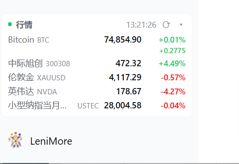
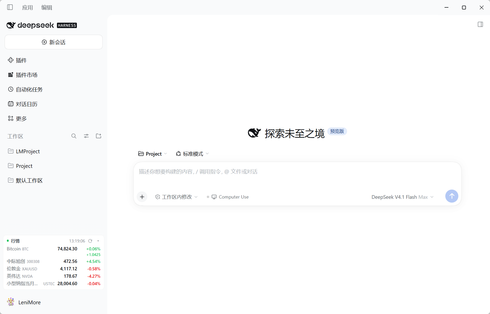
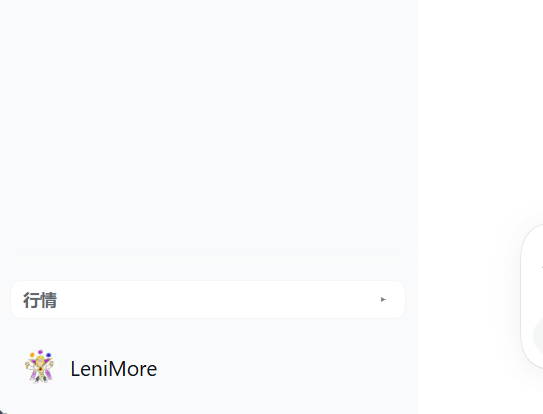
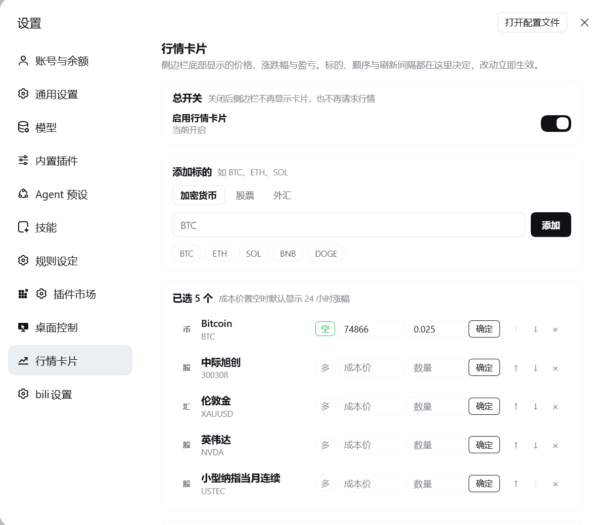
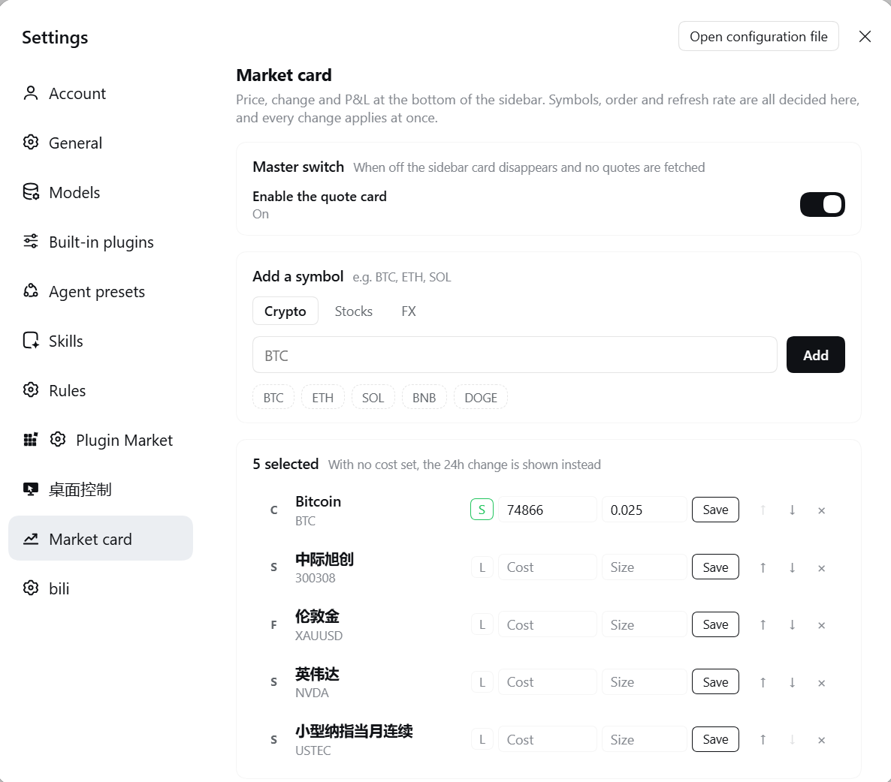

# dsh-market-watching

A market card for the DSH sidebar: crypto, A-shares / HK / US equities, global indices, CME futures continuous contracts, FX and spot metals — live prices, daily change, plus position P&L against your own cost basis. Pick the symbols, their order and the refresh cadence in **DSH Settings**. **No login, no API key.** The UI copy follows the DSH interface language (English / Chinese).

<p align="center">
  
  <br>
  <a href="README.md"></a>
  &nbsp;
  
</p>

## What it does

A compact card at the bottom of the sidebar, one instrument per row: `code · price · change`.

- **Six asset classes, one panel**: crypto (any Gate.io `_USDT` pair), A-shares / HK / US equities, global indices (63 of them — HSI, Nasdaq, Nikkei, DAX, FTSE and friends), CME futures continuous contracts (`USTEC` / `US30` / `US500`, ticking 5×24), FX (majors plus `USDCNH`), spot metals (`XAUUSD` / `XAGUSD`).
- **Change**: crypto uses a rolling 24 h window; equities, indices, FX and metals use the session move. Red-up/green-up and green-up/red-up are one click apart.
- **Cost basis → P&L %**: mark a long entry or a short entry per row (`多` / `空` toggles direction). With a cost set, that column shows the P&L percentage instead of the 24 h move — a short profits when price falls. Clear the field and the 24 h move comes back.
- **Quantity → cash P&L**: type a position size next to the cost (minimum `0.001`). The percentage then gets a second line with the amount in the quote currency, signed for long or short.
- **Master switch**: turn it off and the card disappears from the sidebar while the host stops hitting any upstream. Turn it back on without reloading.
- **Collapse**: the `▾` on the card header folds the whole thing into a single title line; `▸` unfolds. The state lives in `localStorage` and survives reloads.
- **Narrow rail**: when the sidebar shrinks to its rail width the card switches to a compact layout — amount line and fold button hidden, so no empty card.
- **Bilingual**: follows the DSH interface language. Chinese shell gets Chinese copy, anything else gets English, and switching repaints immediately.
- **No login, no key**: every upstream is a public quote endpoint — no account, no token, no auth step.
- **Never blank on failure**: when every upstream fails, the last good quotes stay on screen and dim instead of turning into a row of `--`.

- **A line at the foot of settings**: the settings page ends with a star link and the bare repository address, so giving feedback never means digging through this README.





## Screenshots

Five captures, all under `docs/screenshots/`.

| File | What it shows |
| --- | --- |
| `docs/screenshots/sidebar-card1.png` | Close-up of the card: price, 24h move, and the row carrying a cost basis and a quantity showing both the P&L percentage and the cash amount |
| `docs/screenshots/sidebar-card2.png` | The same card in place at the bottom of the sidebar, in a full desktop window |
| `docs/screenshots/sidebar-collapsed.png` | After clicking `▾`: title and button only, no quotes |
| `docs/screenshots/settings-page-cn.png` | The whole **Settings → Market card** page under a Chinese shell |
| `docs/screenshots/settings-page-en.png` | The same page under an English shell — every label comes from the dictionary |

Collapsed:



Settings page, Chinese shell:



Settings page, English shell:



## Data sources

| Class | Source | Notes |
| --- | --- | --- |
| Crypto | Gate.io `api.gateio.ws/api/v4/spot/tickers` | Public endpoint, polled per pair |
| Equities / indices | East Money `push2.eastmoney.com/api/qt/ulist.np/get` | One request batches every A-share / HK / US / index quote |
| Futures continuous | East Money push2 (`103.NQ00Y` / `103.YM00Y` / `103.ES00Y`) | CME micro Nasdaq / Dow / S&P front month, 5×24, i.e. what a trading terminal calls `USTEC` / `US30` / `US500` |
| FX | East Money push2 | USD majors (`119.`), offshore yuan (`133.`) |
| Spot metals | Sina `hq.sinajs.cn/list=hf_XAU` | London gold / silver; East Money has no spot price for either |

All of these are public quote endpoints — no account, no token, no auth. Every upstream goes through the runtime `fetch`: East Money answers a client with an incomplete header set with an empty `302`, and Sina is blunter still — no referer means 403, and a header set that is not browser-like simply hangs the connection. The zero-dependency HTTPS client in `http.mjs` stays as the fallback for the `proxy` configuration, because `fetch` cannot be told which interface to leave from.

## Install

Use the DSH plugin command. It forwards its arguments verbatim to pnpm inside the profile directory, so one line does the whole install.

Desktop (`desktop` profile):

```powershell
dsh plugin --profile desktop add dsh-market-watching
```

Web (`web` profile):

```powershell
dsh plugin --profile web add dsh-market-watching
```

Restart the process afterwards: close and reopen the DeepSeek Harness desktop app (the host half `index.js` is only assembled at process start), or restart `dsh web` for the web profile. The client half `client.js` is injected when the page loads, so a refresh picks it up.


## Usage

Open **Settings → Market card**:

- Above the input there are three tabs — crypto / equities / FX — but they only swap the shortcut chips and hint text. What a code actually is gets inferred from the code itself: `600519`, `sh600519`, `AAPL`, `00700`, `BTC`, `ETH`, `EURUSD`, `USDCNH`, `USTEC`, `XAUUSD`, `1.600519` and `100.HSI` all resolve. An explicit tab wins when you pick one.
- The master switch at the top: once off, the sidebar stops rendering the card and the host stops calling any upstream; flipping it back needs no page reload.
- Every code is really probed by the host: a hit backfills the official name from the upstream, a miss reports straight away, and an invalid code never lands in settings.
- Each row can move up / move down / be deleted, up to 24 rows.
- On the right of each row sits the **cost basis**: `多` is a long entry (profit when price rises), `空` is a short entry (profit when price falls), and the toggle flips direction. Once set, that card column shows the **P&L %** against cost; leave it empty and the 24 h move stays. Emptying the box clears the cost.
- Cost and quantity are **committed by hand**: fill them in and press `确定` at the row end (or hit Enter). Moving focus away never saves behind your back, and an emptied box plus `确定` clears the value.
- Next to the cost you can type a **quantity** (minimum `0.001`; anything below counts as unset rather than being rounded). With both cost and quantity, the change column gains a **cash P&L** line under the percentage, in the quote currency and signed for long or short; with a cost but no quantity only the percentage shows. The amount hides itself in the narrow rail, and the hover title still carries it.
- Refresh interval 5 / 10 / 15 / 30 / 60 seconds; quote colours `red-up` / `green-up`; show-names toggle.
- Every change applies and persists immediately — there is no save button.

Handy codes:

| Market | Examples |
| --- | --- |
| A-shares | `600519` Kweichow Moutai, `000001` Ping An Bank, `300750` CATL |
| Indices | `000001` SSE Composite (write `1.000001`), `399001` SZSE Component, `100.HSI` Hang Seng, `100.NDX` Nasdaq (cash), `100.DJIA` Dow |
| Contract names | `USTEC` Nasdaq-100 futures, `US30` Dow futures, `US500` S&P futures, `GER40` DAX, `JP225` Nikkei 225, `UK100` FTSE 100, `HK50` Hang Seng, `DXY` dollar index |
| HK equities | `00700` Tencent, `09988` Alibaba |
| US equities | `AAPL`, `NVDA`, `TSLA`, `MSFT` |
| Crypto | `BTC`, `ETH`, `SOL`, `DOGE` (`_USDT` appended automatically) |
| FX | `EURUSD`, `GBPUSD`, `USDJPY`, `AUDUSD`, `USDCAD`, `USDCHF`, `NZDUSD`, `USDCNH` |
| Spot metals | `XAUUSD` London gold (or `XAU`), `XAGUSD` London silver (or `XAG`) |

Names like `USTEC`, `US30` and `US500` come from trading terminals; the plugin maps them onto **CME futures continuous contracts**, which is why they trade 5×24: `USTEC` → `103.NQ00Y` (micro Nasdaq front month), `US30` → `103.YM00Y`, `US500` → `103.ES00Y`. For the cash index that only moves during the New York session, write `NDX100` / `SPX` / `DJIA` (i.e. `100.NDX100` / `100.SPX` / `100.DJIA`), or pass a full secid to skip every heuristic.

Index and A-share codes can collide (`000001` is both Ping An Bank and the SSE Composite). Ask for the index with the full secid `1.000001`, for the stock with `000001`.

## Configuration

The `config` block in `cordis.patch.yml` overrides these defaults (a profile patch can override them too):

| Key | Default | Meaning |
| --- | --- | --- |
| `enabled` | `true` | Master switch. When off the card is not rendered and the host returns an empty snapshot without calling any upstream |
| `schedule` | `15` | Browser poll interval, seconds |
| `cacheMs` | `8000` | Host cache window in milliseconds; requests inside the window share one upstream call |
| `upstreamTimeoutMs` | `7000` | Timeout for a single upstream request |
| `proxy` | empty | Explicit HTTP proxy, e.g. `http://127.0.0.1:7897` |
| `colorScheme` | `red-up` | `red-up` red for gains / `green-up` green for gains |
| `showNames` | `true` | Whether the card shows names |
| `items` | 4 defaults | Initial watchlist; once the user edits settings the settings file wins. Each item may carry `entry: { side: 'long' \| 'short', price }` (cost and direction) and `qty` (quantity, ≥ 0.001) |

## Host routes

| Path | Method | Purpose |
| --- | --- | --- |
| `/api/market.ticker` | GET / POST | Quote snapshot for the current watchlist; `?refresh=1` bypasses the cache |
| `/api/market.settings` | GET / POST | Read and write settings |
| `/api/market.resolve` | POST | Code resolution and validation (returns candidates and official names) |
| `/api/market.notice` | GET / POST | Whether the thank-you card is due (GET) and what the operator chose (POST `thanks` / `issue` / `later`) |

Settings persist to `$DSH_HOME/dsh-market-watching.json` (default `%USERPROFILE%\.dsh\dsh-market-watching.json`). The plugin used to be called `dsh-plugin-market-ticker`; its old file `dsh-market-ticker.json` is adopted automatically on first start and left in place.

The thank-you card writes nothing to disk: its state lives only in the host process. The host hands out one card each time it starts and each time the plug-in is switched on — the first page that opens sees it, later reloads and second tabs do not, and the next activation starts over.

## How it works

- **Host side** (`index.js`): `inject = ['connection']`, and `ctx.connection.fetch.register` installs four exact routes. Inside, instruments are grouped by market: equities / indices / FX merge into one East Money `ulist` batch (40 secids per batch), crypto goes to Gate pair by pair, spot metals merge into one Sina batch. A `cacheMs` cache and `inflight` de-duplication sit in front, and when every upstream fails the response is `degraded: true` with the previous quotes from `lastGood` (`stale: true`), so the card never goes blank. Position maths runs on the host: `positionPnl(entry, price)` yields the percentage (long `(price - cost) / cost`, inverted for shorts) and `positionAmount(entry, qty, price)` yields the cash amount (price delta × quantity, inverted for shorts), shipped as `pnlPercent` / `pnlAmount`; the client only renders them. Error responses carry a `code` (`badJson` / `writeFailed` / `unknownCode` / `noQuote`) next to `message`, so the client can re-render the text in the current language.
- **Client side** (`client.js`): `inject = ['slots', 'locale']`, registering `sidebar.footer.action` (the card), `settings.section` (the settings page) and `settings.section.icon` (the nav icon). Styling uses `--dsw-alias-*` theme tokens only, so it follows light and dark themes.

## Language

UI copy follows the DSH interface language and never reads `navigator.language`. In `apply` the plugin calls `ctx.locale.register('marketTicker', { zh, en })` and then `ctx.locale.bind('marketTicker')` for the translation function. The DSH locale service ships only `zh` and `en`, and its fallback chain always ends at `en`, so Chinese (including variants such as `zh-Hant`) hits the Chinese table and every other language hits English. `ctx.locale.subscribe` drives repaints on a language switch — no reload needed.

Chinese literals are not allowed in the component tree outside the dictionary; `scripts/check-i18n.mjs` catches copy that was missed:

```bash
node scripts/check-i18n.mjs   # key parity between both tables + no CJK literals outside them
```

Instrument names in the quote data (e.g. 贵州茅台, 小型纳指当月连续) come from the upstreams and display as-is, regardless of interface language.

## Tests

```bash
node tests/host.test.mjs      # host: code inference, caching, real upstream quotes, settings round-trip
node tests/client.test.mjs    # client: module wiring, slot registration, settings label, both languages
node scripts/check-i18n.mjs   # dictionary completeness
node scripts/probe-ticker.mjs # hit the ticker route once, print real quotes and latency
```

`node --test tests/` fails inside a restricted sandbox because spawning is blocked, so run `node <file>` directly. Six host tests hit live upstreams and will go red when an upstream hiccups — that is the network wobbling, not broken logic.

## Troubleshooting

- **No card in the sidebar**: first check whether the master switch in settings is off; then that at least one instrument exists; then that the package is installed in the current profile (`dsh plugin --profile desktop why dsh-market-watching`); finally restart the process.
- **Card shows `--`**: upstreams are unreachable. Check that the machine can reach `push2.eastmoney.com`, `api.gateio.ws` and `hq.sinajs.cn` directly; behind a proxy, put the proxy address in `config.proxy` (the Sina path then uses the same client, so if it is blocked, drop the proxy or go direct).
- **A symbol is rejected**: the host could not get a quote for that code. Try another form (market prefix for A-shares, a full secid for indices).
- **All copy is English**: interface language follows DSH — switch it to Chinese in DSH's own language setting. Takes effect immediately, no restart.
- **Settings page 404**: the host plugin did not assemble. Look for `market-watching` errors in the DSH startup log.

## Uninstall

```powershell
dsh plugin --profile desktop remove dsh-market-watching
```

For the web profile, swap `--profile desktop` for `--profile web`. Restart the process afterwards. The settings file `%USERPROFILE%\.dsh\dsh-market-watching.json` can stay (it is reused on reinstall) or be deleted.

## License

MIT
