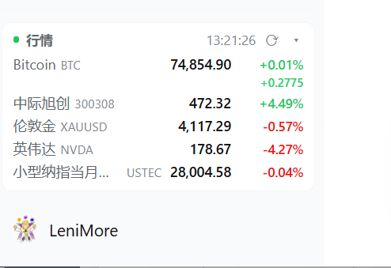
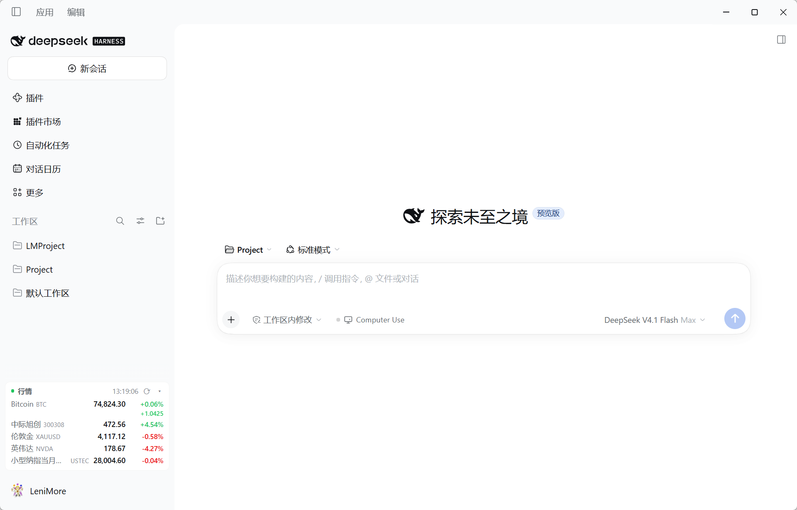
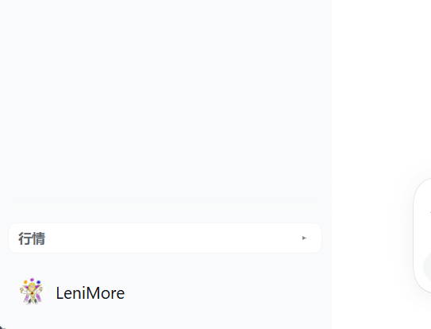
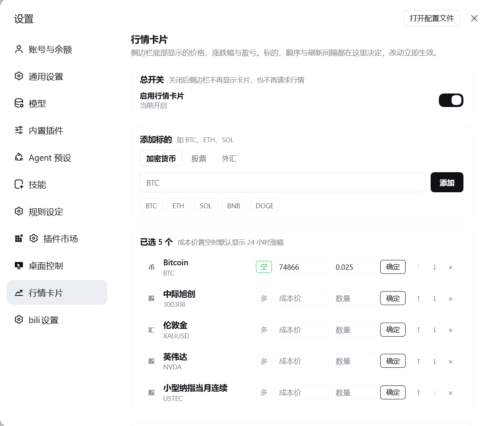
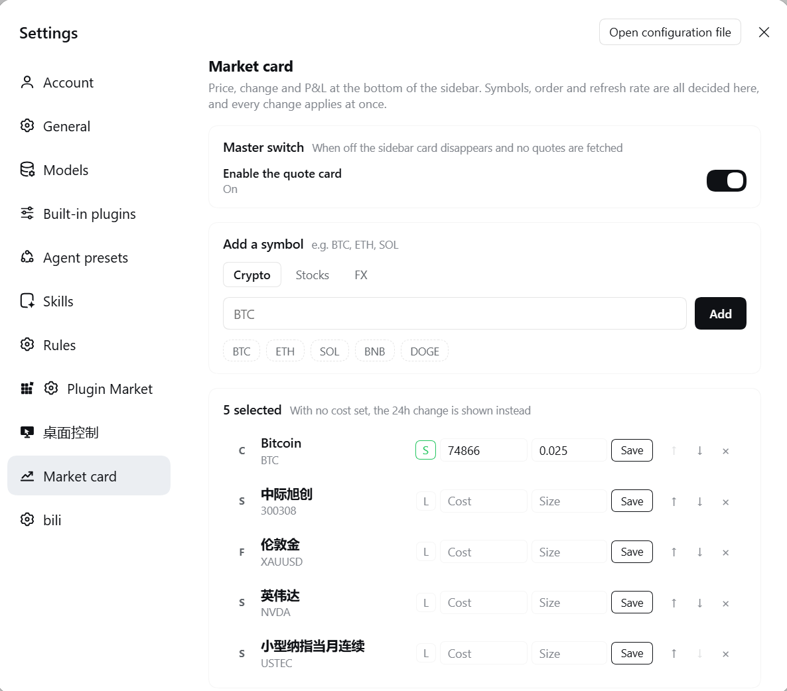

# dsh-market-watching

DSH 侧栏行情卡片：加密货币、A股 / 港股 / 美股、国际指数、CME 期货连续合约、外汇、现货金银，实时价格与涨跌幅一览，还能按自己填的成本价算持仓盈亏。标的、顺序、刷新节奏全在 **DSH 设置页**里定，**无需登录、无需 API Key**，界面文案跟随 DSH 的界面语言（中文 / 英文）。

<p align="center">
  
  <br>
  
  &nbsp;
  <a href="README.en.md"></a>
</p>

## 能做什么

侧栏底部一张紧凑卡片，一行一个标的：`代码 · 现价 · 涨跌幅`。

- **六个品类一个面板**：加密货币（Gate.io 任意 `_USDT` 交易对）、A 股 / 港股 / 美股、国际指数（恒生、纳指、日经、DAX、富时等 63 个）、CME 期货连续合约（`USTEC` / `US30` / `US500`，5×24 跳动）、外汇（美元直盘 + `USDCNH`）、现货金银（`XAUUSD` / `XAGUSD`）。

- **涨跌幅**：加密货币按 24 小时滚动算，股票、指数、外汇、金属按当日涨跌算；红涨绿跌与绿涨红跌一键切换。

- **成本价 → 盈亏%**：每项可标一个买入价或做空价（`多` / `空` 可翻转）。设了成本，那一列改显示相对成本的盈亏百分比，做空跌了才算赚；没设成本就照旧显示 24 小时涨跌幅。

- **数量 → 浮动盈亏金额**：成本价旁边填持仓数量（最低 `0.001`），百分比下面再多一行金额，按报价货币计，多空各自取符号。

- **总开关**：关掉之后卡片从侧栏消失，宿主也不再向上游发任何请求；开回来不用刷新页面。

- **折叠**：卡片头部右侧 `▾` 把整张卡收成一行，只剩标题与按钮；`▸` 展回。折叠状态记在 `localStorage`，刷新后保持。

- **窄轨自适应**：侧栏收成窄版时自动切紧凑排版，金额行与折叠按钮隐藏，避免挤出空卡。

- **双语**：跟随 DSH 的界面语言，中文环境全中文、其他语言全英文，切换即时重绘。

- **免登录免密钥**：全部走公开行情接口，没有账号、令牌、鉴权环节。

- **断线不空白**：上游整体失败时保留上一次报价并淡化显示，卡片不会突然变成一排 `--`。

  

  



## 截图

五张图都在 `docs/screenshots/` 下。

| 文件 | 拍什么 |
| --- | --- |
| `docs/screenshots/sidebar-card1.png` | 卡片近景：价格、24 小时涨跌，以及填了成本价和数量的那一行同时给出盈亏% 与浮动金额 |
| `docs/screenshots/sidebar-card2.png` | 同一张卡片贴在侧栏底部、整个窗口的取景 |
| `docs/screenshots/sidebar-collapsed.png` | 点了 `▾` 之后：只剩标题和按钮，行情一条不显示 |
| `docs/screenshots/settings-page-cn.png` | 中文界面下的**设置 → 行情卡片**整页：总开关、添加标的、自选列表 |
| `docs/screenshots/settings-page-en.png` | 英文界面下的同一页，文案全部跟着字典走 |

折叠态：



设置页：

Chinese:



English:



## 数据源

| 类别 | 来源 | 说明 |
| --- | --- | --- |
| 加密货币 | Gate.io `api.gateio.ws/api/v4/spot/tickers` | 公开接口，按交易对轮询 |
| 股票 / 指数 | 东方财富 `push2.eastmoney.com/api/qt/ulist.np/get` | 一次请求批量取全部 A 股/港股/美股/指数 |
| 期货连续合约 | 东方财富 push2（`103.NQ00Y` / `103.YM00Y` / `103.ES00Y`） | CME 小型纳指/道指/标普当月连续，5×24 交易，即终端里的 `USTEC` / `US30` / `US500` |
| 外汇 | 东方财富 push2 | 美元直盘（`119.`）、离岸人民币（`133.`） |
| 现货贵金属 | 新浪 `hq.sinajs.cn/list=hf_XAU` | 伦敦金 / 伦敦银，东方财富没有这两个现货价 |

全部是公开行情接口，不涉及账号、令牌与鉴权。三路上游都走运行时自带的 `fetch`：东方财富对头不全的客户端会回 `302` 空响应，新浪更直接——不带 referer 直接 403、头凑不齐就把连接吊死，只有浏览器式请求才放行。`http.mjs` 那个零依赖 HTTPS 客户端留着给配置了 `proxy` 的场景兜底，因为 `fetch` 改不了出口。

## 安装

用 DSH 自带的插件命令，一条就够——它把参数原样转发给 profile 目录里的 pnpm。

桌面版（`desktop` profile）：

```powershell
dsh plugin --profile desktop add dsh-market-watching
```

Web 版（`web` profile）：

```powershell
dsh plugin --profile web add dsh-market-watching
```

装完重启对应进程才算数：桌面版关掉重开 DeepSeek Harness（宿主 `index.js` 只在进程启动时装配），Web 版重启 `dsh web`。客户端 `client.js` 是页面加载时注入的，刷新一次就换。

## 使用

打开 **设置 → 行情卡片**：

- 输入框上方有「加密货币 / 股票 / 外汇」三档，切换只是换快捷标签与提示，真正认哪个市场靠代码本身：`600519`、`sh600519`、`AAPL`、`00700`、`BTC`、`ETH`、`EURUSD`、`USDCNH`、`USTEC`、`XAUUSD`、`1.600519`、`100.HSI` 都能直接认出来。设了档位就以档位为准。
- 顶部「总开关」：关闭后侧栏不再渲染卡片，宿主也不再请求任何上游；开回来不需要刷新页面。
- 代码会被宿主真实探测一遍：命中就用接口返回的官方名称回填，未命中直接提示，不会把无效代码存进设置。
- 每项可上移 / 下移 / 删除，最多 24 项。
- 每项右侧可填**成本价**：`多` = 买入价（涨了才算赚），`空` = 做空价（跌了才算赚），切换按钮翻转方向。填了之后卡片那一列改显示相对成本的**盈亏%**；没填就照旧显示 24 小时涨跌幅。清空输入框即取消成本。
- 成本价与数量都是**手动提交**：填完点该行末尾的「确定」（或按回车）才写入，光标移开不会偷偷保存，清空后再点确定就是取消。
- 成本价右边还能填**数量**（最低 `0.001`，低于这个值视为没填、不四舍五入）。同时有成本和数量时，涨跌列会在百分比下面多出一行**浮动盈亏金额**（按报价货币计，多空方向各自取符号）；只有成本没数量时只显示百分比。窄栏模式下金额自动隐藏，悬停标题里仍能看到。
- 刷新间隔 5 / 10 / 15 / 30 / 60 秒；涨跌配色 `红涨绿跌` / `绿涨红跌`；显示名称开关。
- 所有改动即时生效并落盘，没有「保存」按钮。

常用代码速查：

| 市场 | 例子 |
| --- | --- |
| A 股 | `600519` 贵州茅台、`000001` 平安银行、`300750` 宁德时代 |
| 指数 | `000001` 上证指数（写作 `1.000001`）、`399001` 深证成指、`100.HSI` 恒生、`100.NDX` 纳指（现货）、`100.DJIA` 道指 |
| 合约名 | `USTEC` 纳指100期货、`US30` 道指期货、`US500` 标普期货、`GER40` 德国 DAX、`JP225` 日经225、`UK100` 富时100、`HK50` 恒生、`DXY` 美元指数 |
| 港股 | `00700` 腾讯控股、`09988` 阿里巴巴 |
| 美股 | `AAPL`、`NVDA`、`TSLA`、`MSFT` |
| 加密 | `BTC`、`ETH`、`SOL`、`DOGE`（自动补 `_USDT`） |
| 外汇 | `EURUSD`、`GBPUSD`、`USDJPY`、`AUDUSD`、`USDCAD`、`USDCHF`、`NZDUSD`、`USDCNH` |
| 现货金属 | `XAUUSD` 伦敦金（也可写 `XAU`）、`XAGUSD` 伦敦银（也可写 `XAG`） |

`USTEC`、`US30`、`US500` 这类是交易终端里的合约名，插件把它们映射到 **CME 期货连续合约**，所以是 5×24 交易的：`USTEC` → `103.NQ00Y`（小型纳指当月连续）、`US30` → `103.YM00Y`、`US500` → `103.ES00Y`。想要只在纽约时段跳动的现货指数，写 `NDX100` / `SPX` / `DJIA`（对应 `100.NDX100` / `100.SPX` / `100.DJIA`），或直接写完整 secid 绕过所有猜测。

指数与 A 股代码可能重号（`000001` 既是平安银行也是上证指数）。要指数时写完整 secid `1.000001`，要个股时写 `000001`。

## 配置项

`cordis.patch.yml` 的 `config` 可覆盖以下默认值（也可在 profile 的 patch 里覆盖）：

| 键 | 默认 | 含义 |
| --- | --- | --- |
| `enabled` | `true` | 总开关。关闭后卡片不渲染、宿主直接返回空快照，不请求任何上游 |
| `schedule` | `15` | 浏览器轮询间隔（秒） |
| `cacheMs` | `8000` | 宿主缓存窗口（毫秒），同窗口内多次请求复用一次上游 |
| `upstreamTimeoutMs` | `7000` | 单次上游请求超时 |
| `proxy` | 空 | 显式 HTTP 代理，如 `http://127.0.0.1:7897` |
| `colorScheme` | `red-up` | `red-up` 红涨绿跌 / `green-up` 绿涨红跌 |
| `showNames` | `true` | 卡片是否显示名称 |
| `items` | 4 项默认 | 初始标的列表，用户改过设置后以设置文件为准。每项可带 `entry: { side: 'long' \| 'short', price }`（成本与方向）和 `qty`（数量，≥0.001） |

## 宿主路由

| 路径 | 方法 | 用途 |
| --- | --- | --- |
| `/api/market.ticker` | GET / POST | 当前标的的报价快照；`?refresh=1` 强制绕过缓存 |
| `/api/market.settings` | GET / POST | 读写设置 |
| `/api/market.resolve` | POST | 代码解析与校验（返回候选与官方名称） |
| `/api/market.notice` | GET / POST | 是否该弹出道谢卡片（GET），以及记录用户的选择（POST `thanks` / `issue` / `later`） |

设置落盘在 `$DSH_HOME/dsh-market-watching.json`（默认 `%USERPROFILE%\.dsh\dsh-market-watching.json`）。插件改名前叫 `dsh-plugin-market-ticker`，旧文件 `dsh-market-ticker.json` 会在首次启动时被自动接管，原文件保留不删。

道谢卡片的计数单独落在 `$DSH_HOME/dsh-market-watching.notice.json`，不写进设置文件：设置每次读写都会被规范化，未知字段留不住，用户一存自选就会把计数洗掉。

## 工作方式

- **宿主侧**（`index.js`）：`inject = ['connection']`，用 `ctx.connection.fetch.register` 注册四条精确路由。内部把标的按市场分组，股票/指数/外汇合并成一次东财 `ulist` 批量请求（每批 40 个 secid），加密逐个走 Gate，现货金属合并成一次新浪批次请求。带 `cacheMs` 缓存与 `inflight` 去重，上游整体失败时返回 `degraded: true` 并沿用 `lastGood` 里的上一次报价（`stale: true`），不会把卡片打空。持仓盈亏由宿主算：`positionPnl(entry, price)` 出百分比（多头 `(现价-成本)/成本`，空头取反），`positionAmount(entry, qty, price)` 出金额（价格差 × 数量，空头取反），分别以 `pnlPercent` / `pnlAmount` 下发，客户端只负责显示。错误响应除 `message` 外还带 `code`（`badJson` / `writeFailed` / `unknownCode` / `noQuote`），供客户端按当前语言重新渲染。
- **客户端侧**（`client.js`）：`inject = ['slots', 'locale']`，注册 `sidebar.footer.action`（卡片）、`settings.section`（设置页）、`settings.section.icon`（导航图标）。样式只用 `--dsw-alias-*` 主题 token，跟随深浅色主题。

## 语言

界面文案跟随 DSH 的界面语言，不读浏览器 `navigator.language`。插件在 `apply` 里 `ctx.locale.register('marketTicker', { zh, en })`，再用 `ctx.locale.bind('marketTicker')` 拿翻译函数；DSH 的 locale 服务只内置 `zh` 与 `en`，fallback 链末端固定落 `en`，所以中文（含 `zh-Hant` 等中文变体）命中中文，其他语言命中英文。语言切换由 `ctx.locale.subscribe` 驱动重渲染，无需刷新。

字典外的组件树里不允许出现中文字面量，`scripts/check-i18n.mjs` 会拦下漏翻的文案：

```bash
node scripts/check-i18n.mjs   # 两份字典 key 对齐 + 字典外无中文字面量
```

行情数据里的品种名（如「贵州茅台」「小型纳指当月连续」）来自上游接口，按数据原样显示，不随界面语言变化。

## 测试

```bash
node tests/host.test.mjs     # 宿主：代码解析、缓存、真实网络取价、设置往返
node tests/client.test.mjs   # 客户端：模块装配、槽位注册、设置页标签、中英文案
node scripts/check-i18n.mjs  # 字典完整性
node scripts/probe-ticker.mjs # 打一次 ticker 路由，打印真实报价与耗时
```

`node --test tests/` 在受限沙箱里因 spawn 被拦而失败，直接 `node <file>` 跑即可。宿主测试有 6 条打真实上游，上游抽风时会红——那是网络在抖，不是逻辑坏了。

## 故障排查

- **侧栏没有卡片**：先看设置里的总开关是不是被关了；再确认至少有一个标的；再确认包装进了当前 profile（`dsh plugin --profile desktop why dsh-market-watching`）；最后重启对应进程。
- **卡片显示 `--`**：上游不通。检查网络能否直连 `push2.eastmoney.com`、`api.gateio.ws` 与 `hq.sinajs.cn`；若走代理，在 `config.proxy` 填上代理地址（新浪那一路在配置代理后也走同一客户端，若被拦就把代理关掉或改用直连）。
- **添加标的被拒**：说明宿主用报价接口探测不到该代码，换个写法（A 股带市场前缀、指数写完整 secid）。
- **文案全是英文**：界面语言跟着 DSH 走，去 DSH 自己的语言设置里切成中文即可，改完即时生效，不用重启。
- **设置页 404**：宿主插件没装配成功，看 DSH 启动日志里 `market-watching` 相关报错。

## 卸载

```powershell
dsh plugin --profile desktop remove dsh-market-watching
```

Web 版就把 `--profile desktop` 换成 `--profile web`。卸完重启对应进程。设置文件 `%USERPROFILE%\.dsh\dsh-market-watching.json` 可以留着（重装后接着用），也可以直接删。

## License

MIT
